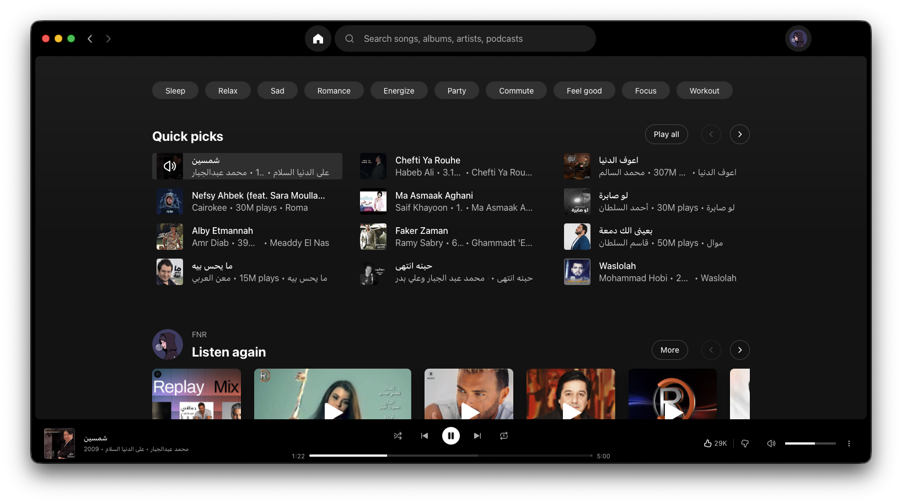
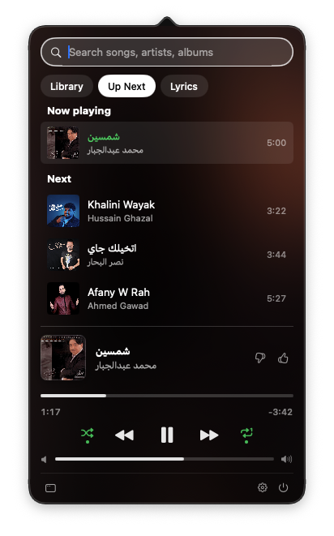

# YT Music — native desktop clients

Unofficial native desktop apps for [YouTube Music](https://music.youtube.com).
Not affiliated with Google or YouTube.

| Platform | Status  | Stack                                   | Folder                 |
|----------|---------|-----------------------------------------|------------------------|
| macOS    | working | Swift 6, AppKit + SwiftUI, WKWebView    | [`macos/`](macos/)     |
| Windows  | early   | C#/.NET 10, WPF, WebView2               | [`windows/`](windows/) |

## Screenshots

macOS, with the Spotify-style theme:



Menu bar mini-player (Up Next tab):



## How it works

YouTube Music has no public playback API, and its audio streams are signed per
session, so a "fully native" player would have to scrape private endpoints that
break often and violate the terms of service. Each app instead hosts the real
web player in the **system web view** and puts native features around it:

```
┌──────────── native host (Swift / C#) ────────────┐
│  window · menus · media keys · Now Playing / SMTC │
│  tray / menu bar mini-player · notifications      │
│                     ▲      │                      │
│      state (JSON)   │      │  commands (JS call)  │
│                     │      ▼                      │
│  ┌─────────── system web view ─────────────────┐  │
│  │ music.youtube.com  +  shared/bridge/*.js     │  │
│  └─────────────────────────────────────────────┘  │
└───────────────────────────────────────────────────┘
```

The page-side code lives in [`shared/`](shared/) and is the same for every
platform:

- [`shared/bridge/ytm-bridge.js`](shared/bridge/ytm-bridge.js): injected script
  that reports player state and runs commands (play, next, seek, like, volume…)
- [`shared/PROTOCOL.md`](shared/PROTOCOL.md): the message format both hosts implement
- [`shared/themes/`](shared/themes/): optional stylesheets the hosts inject, such as
  `spotify-style.css`, whose colours, spacing, radii, type and control sizes and
  panel geometry were measured from the installed Spotify desktop client
  (1.3.0.277). The rules are our own; no Spotify code, fonts, icons or branding
  are included, and text uses the system font.

When YouTube Music changes its DOM, the fix usually goes in `ytm-bridge.js`
alone, and every platform picks it up.

## macOS

Requirements: macOS 14+, Xcode 16+, [XcodeGen](https://github.com/yonaskolb/XcodeGen) (`brew install xcodegen`).

```bash
cd macos && scripts/build.sh
```

```bash
open "macos/build/YT Music.app"
```

To work in Xcode, run `xcodegen generate` in `macos/` and open
`YTMusic.xcodeproj`. The project file is generated, so edit `project.yml`
rather than the `.xcodeproj`.

### Features

- Google sign-in persists across launches; non-YouTube links open in your browser
- **Menu bar controls**:
  - Left-click: mini-player with artwork, a seekable progress bar, play/pause,
    previous/next, like/dislike and volume
  - Search with YT Music's own filters (Songs, Videos, Artists, …): click to
    play, or right-click / "…" for Play Next, Add to Queue and Go to Artist /
    Album / Playlist
  - Library tab: recently played and your playlists
  - Up Next tab: the current queue; click a track to skip ahead to it
  - Lyrics tab: the current song's lyrics from YT Music, with its source credit
    (right-to-left scripts are right-aligned)
  - Shuffle and repeat toggles (also in the Playback menu)
  - Right-click: quick controls menu
  - Optional: current track title next to the icon (Settings)
- Media keys, AirPods, Control Center and the Lock Screen through Now Playing
- Dock menu with playback controls
- Track-change notifications (only while the app is in the background; ads skipped)
- Closing the window keeps the music playing; click the Dock icon to bring it back
- Themes: Spotify-style (default) or stock YouTube Music, switchable live in Settings.
  The Spotify-style theme also changes the window: there's no separate title
  strip, the traffic lights and back/forward arrows sit in the black top bar,
  and the top bar's empty space drags the window (double-click zooms). It hides
  YT Music's sidebar; Home is the round button beside search
- Volume stays in sync between the app's controls and YouTube Music's own
  slider, and is remembered across launches
- Keyboard shortcuts:

  | Action             | Shortcut |
  |--------------------|----------|
  | Play/Pause         | ⌘↩       |
  | Next / Previous    | ⌘→ / ⌘←  |
  | Skip ±10 s         | ⌥⌘→ / ⌥⌘← |
  | Volume             | ⌘↑ / ⌘↓  |
  | Like / Dislike     | ⌘L / ⇧⌘L |
  | Search             | ⌘F       |
  | Back / Forward     | ⌘[ / ⌘]  |
  | Home               | ⇧⌘H      |

Debug builds enable the Safari Web Inspector: Safari → Develop → *your Mac* → YT Music.
They also add **Debug → Evaluate Clipboard JavaScript** (⌃⌥⌘J), which runs the
clipboard as an async function body in the page and copies the JSON result back.
It's handy for scripting DOM checks against the real app.

Note: YouTube Music serves different player markup to different browsers.
WKWebView (Safari) gets the newer `ytmusic-miniplayer` player; Chromium gets the
classic `ytmusic-player-bar`. The bridge and theme handle both, so check DOM
changes in the app itself, not only in Chrome.

### Layout

```
macos/
  project.yml                 XcodeGen spec (sandboxed, hardened runtime)
  scripts/build.sh            CLI build → build/YT Music.app
  scripts/make-icon.swift     renders the app icon
  YTMusic/
    App/        entry point, app delegate, main menu, shared menu actions
    Window/     main window + WKWebView, navigation policy
    Player/     PlayerModel (state), WebBridge, Now Playing, notifications, artwork
    MenuBar/    status item + SwiftUI mini-player popover
    Settings/   preferences
```

## Windows

Early version: the YouTube Music window with the shared bridge and Spotify-style
theme, a tray icon with playback controls, track-change notifications and
media keys. Every push builds a self-contained `YTMusic.exe` on GitHub Actions
(download it from the latest
[Windows build](https://github.com/FnrDev/yt-music/actions/workflows/windows.yml) run).
See [`windows/README.md`](windows/README.md) for details and what's next.
